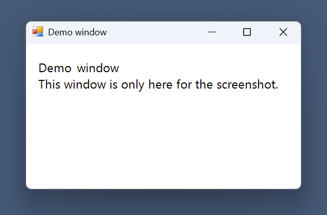
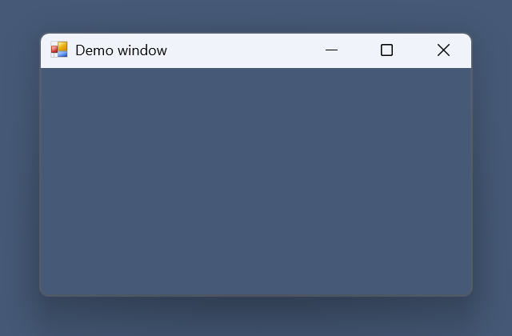
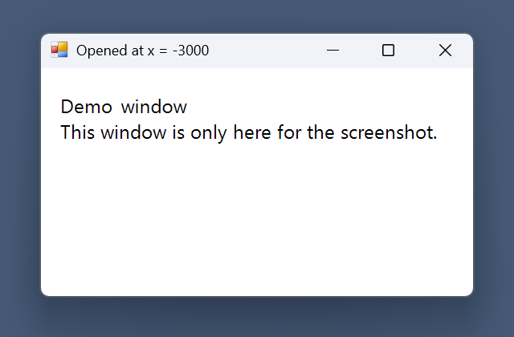
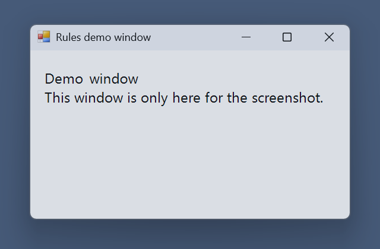

# windhawk-mods

Custom [Windhawk](https://windhawk.net) mods for Windows 11.

## Mods
- `mods/offscreen-window-rescue.wh.cpp`: moves any normal window back onto the screen when it first opens outside the visible area. It runs in all apps except File Explorer and core system processes. It checks each window once, so you can still drag windows partly off the edge.
- `mods/same-app-window-cycler.wh.cpp`: Alt+` cycles between windows of the current app, like Cmd+` on a Mac.
- `mods/focus-follows-mouse.wh.cpp`: focus the window under the mouse without raising it, like many Linux desktops.
- `mods/titlebar-scroll-rollup.wh.cpp`: scroll on a title bar to roll the window up to its title bar and back.
- `mods/window-rules.wh.cpp`: per-app position, size, monitor, always-on-top and opacity rules, like KDE window rules.

## Screenshots
The windows below are plain test windows on a blank backdrop.

Title bar roll-up. Scroll up on the title bar to roll the window up. The frame outline stays, and the content area is hidden. Scroll down to bring it back.




Off-screen rescue. A test window was opened at x = -3000. The mod moved it to x = 1000, y = 630 on a 2560 by 1600 screen.



Window rules. One rule matches a test window by app and title. It opened at 60, 60 with size 380 by 220. The rule moved it to 500, 300, resized it to 560 by 340 and set opacity to 80.



The window cycler and focus follows mouse don't have screenshots. A still image can't show them.

## Install
1. Open Windhawk and create a new mod.
2. Paste the file contents and compile.

Or from an elevated shell:

```
windhawk-cli.exe mod install --file mods/offscreen-window-rescue.wh.cpp
```

## Status
Tested on Windows 11 build 26300 with a single monitor. The new mods compile but aren't live tested yet. For the rescue mod, a window opened at x=-3000 stayed there with the mod off and moved to the center with the mod on. It hasn't been tested on a real MSI installer yet.

## License
MIT
