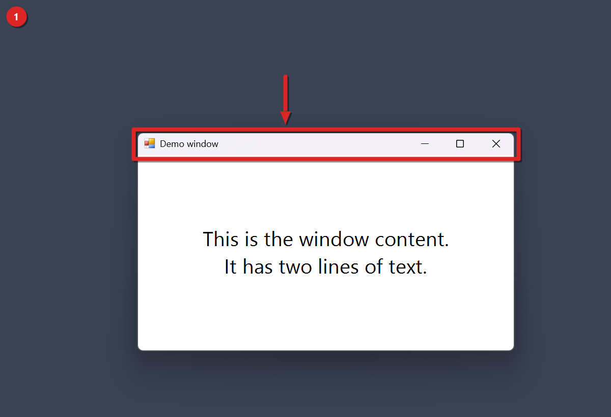
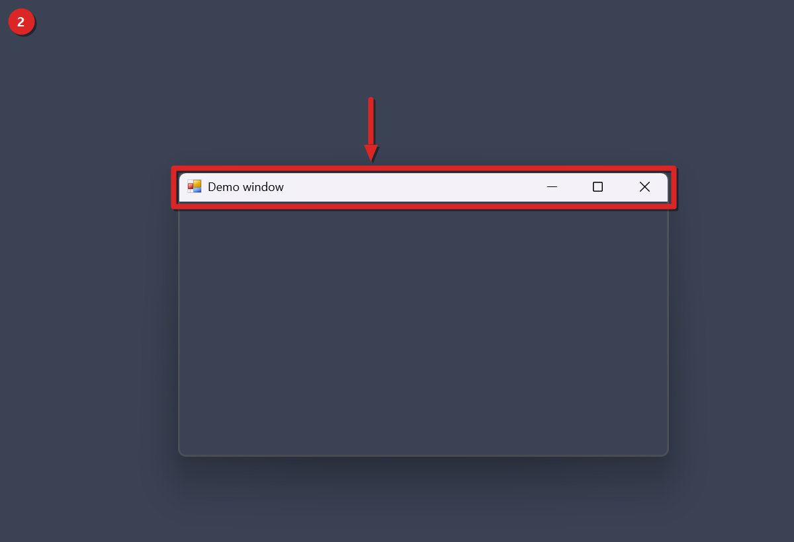
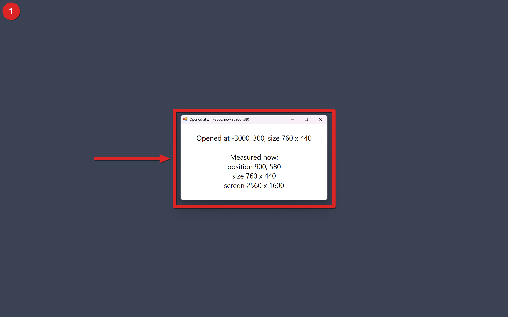
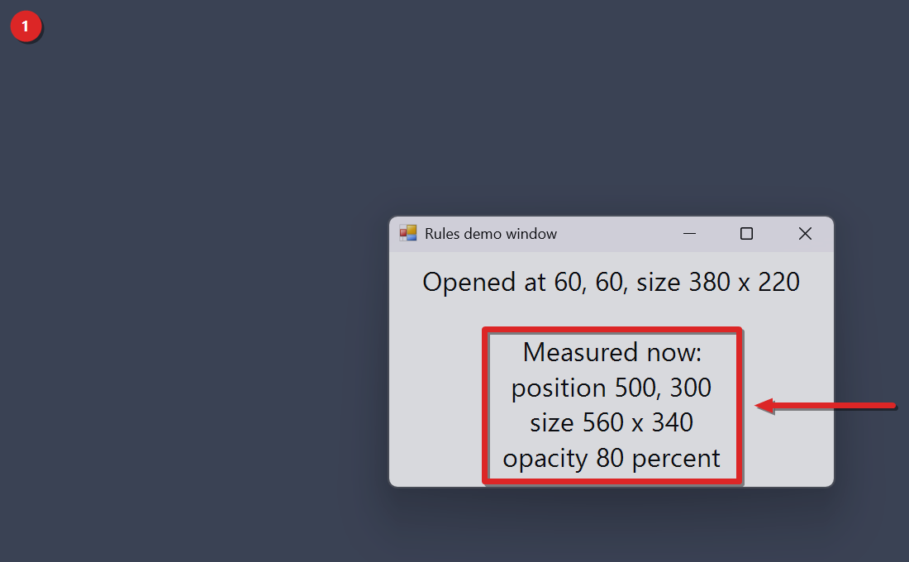

# Windhawk mods for Windows 11: window management, focus, and clipboard fixes

A set of eight custom [Windhawk](https://windhawk.net) mods for Windows 11. Seven of them fix a single everyday annoyance: windows that open off screen, no way to cycle through an app's windows, focus that needs a click, tall title bars you can't fold away, apps that forget where you put them, a clipboard that freezes, and Copy as path when you only want the names of one or many files and folders. The eighth logs which Windows API call Windows Update uses when it restarts your PC. They're written in C++, they're MIT licensed, and you can install any of them on its own.

We build these because Windows 11 leaves small gaps that Mac and Linux desktops filled years ago. We'd rather patch a gap once, in a mod we can read and change, than live with it or install a large tweaking suite for one feature.

## Documentation
Each mod has its own step-by-step tutorial in the docs folder. The [docs index](docs/README.md) lists all of them.

## Contents
- [Quick summary](#quick-summary)
- [Why we build these mods](#why-we-build-these-mods)
- [The mods](#the-mods)
- [Install](#install)
- [Screenshots](#screenshots)
- [Questions and answers](#questions-and-answers)
- [Mod reference](#mod-reference)
- [Status](#status)
- [Disclaimer](#disclaimer)
- [License](#license)

## Quick summary
| Mod | Problem it solves | Runs in | File |
| --- | --- | --- | --- |
| Off-Screen Window Rescue | A window opens outside the visible screen and you can't reach it | All apps except File Explorer and core system processes | `mods/offscreen-window-rescue.wh.cpp` |
| Same-App Window Cycler | No quick key to switch between windows of one app | explorer.exe | `mods/same-app-window-cycler.wh.cpp` |
| Focus Follows Mouse | Focus needs a click | explorer.exe | `mods/focus-follows-mouse.wh.cpp` |
| Title Bar Scroll Roll-Up | A window you want to fold out of the way | explorer.exe | `mods/titlebar-scroll-rollup.wh.cpp` |
| Window Rules | Apps open at a random spot, size, or opacity every time | All apps except File Explorer and core system processes | `mods/window-rules.wh.cpp` |
| Clipboard Hang Watchdog | Copy and paste stop working and you don't know why | explorer.exe | `mods/clipboard-hang-watchdog.wh.cpp` |
| Bulk Copy File and Folder Names | Copy as path gives full paths when you only want the names of one or many files and folders | explorer.exe | `mods/bulk-copy-file-and-folder-names.wh.cpp` |
| Restart API Logger | Windows Update restarts your PC and you can't tell which API call it used | MoUsoCoreWorker.exe and TrustedInstaller.exe | `mods/restart-api-logger.wh.cpp` |

## Why we build these mods
Windhawk lets you change how Windows behaves by injecting small pieces of code into running programs. It doesn't patch system files on disk. That makes it a good fit for narrow fixes, because a mod is one readable file and you can turn it off at any time.

We follow three rules when we write a mod:
- It does one job. If a fix needs a second feature, it becomes a second mod.
- It ships with settings and safe defaults. Anything that could end a program, like the clipboard watchdog, starts in log-only mode.
- It says what it can't do. Every section below lists its limits.

The first mod in this repo came from a real problem. A Windows installer opened its window outside the visible area and wouldn't come back. That's why the rescue mod exists, and why it checks each window once instead of fighting you every time you drag one near an edge.

## The mods
Each mod has a step-by-step tutorial in the docs folder, with a screenshot for each step where one was captured. The sections below are short on purpose. The tutorial has the settings, the limits and what's been tested.

### Off-Screen Window Rescue
Some windows open at coordinates that don't exist on your screen. Installers, old apps, and apps that remember a monitor you've unplugged do this. When a normal window first appears and less than half of it is visible, with the default setting, this mod moves it to the center of the work area. It checks each window once, so you can still drag a window partly off the edge afterward.

Settings: minVisiblePercent (default 50) and logMoves (default on). It skips File Explorer and core system processes.

Full guide: [Off-Screen Window Rescue tutorial](docs/offscreen-window-rescue.md).

### Same-App Window Cycler
Alt+Tab shows every window from every app. Press Alt plus the backtick key, the key above Tab on a US keyboard, and this mod moves between the windows of the app you're using, like Cmd plus the backtick key on a Mac.

Settings: modifier (default Alt), includeMinimized (default on) and currentDesktopOnly (default on).

Full guide: [Same-App Window Cycler tutorial](docs/same-app-window-cycler.md).

### Focus Follows Mouse
On Windows, the window under your pointer doesn't get keyboard focus until you click it. This mod focuses the window under the mouse after a short delay. By default it doesn't raise the window, so a window you're reading stays on top while you type in the one underneath.

Settings: enabled (default on), delayMs (default 300) and raiseWindow (default off).

Full guide: [Focus Follows Mouse tutorial](docs/focus-follows-mouse.md).

### Title Bar Scroll Roll-Up
Scroll the mouse wheel up on a title bar and the window rolls up to its title bar. Scroll down and it comes back. The frame outline stays and the content is hidden, so the window keeps its place without being minimized or closed.

Settings: enabled (default on), reverse (default off) and modifier (default none).

Full guide: [Title Bar Scroll Roll-Up tutorial](docs/titlebar-scroll-rollup.md).

### Window Rules
Some apps open in a different place and size every time, and Windows has no built-in way to pin them. You write a rule for an app, and this mod applies it when that app's window first opens. A rule can set position, size, monitor, maximize, always-on-top and opacity.

Settings: enabled and logRules, both on by default, and a list of rules. Each rule needs a process name like notepad.exe. It skips File Explorer and the same core system processes as the rescue mod.

Full guide: [Window Rules tutorial](docs/window-rules.md).

### Clipboard Hang Watchdog
Copy and paste stop working, sometimes for many seconds, and Windows doesn't tell you which program is responsible. This mod checks the clipboard every 500 ms. When a program holds it open past your threshold, or the clipboard owner stops responding, it writes the program name and process ID to %LOCALAPPDATA%\clipboard-hang-watchdog.log. It starts in log-only mode. In endHolder mode it can also end the holder.

Settings: thresholdSeconds (default 5), action (default logOnly), killAfterSeconds (default 15), maxLogKB (default 100) and protectedProcesses.

Full guide: [Clipboard Hang Watchdog tutorial](docs/clipboard-hang-watchdog.md).

### Bulk Copy File and Folder Names
Copy as path (Ctrl+Shift+C) gives you full paths in quotes. Select one or more files and folders in File Explorer and press Ctrl+Shift+N, and this mod copies only their names, one per line. Ctrl+Alt+Shift+N copies them without extensions, and folders keep their full name. The classic right-click menu gets Copy name and Copy name without extension too. Ctrl+Shift+N is also File Explorer's New folder key, and the mod takes it over while it's on.

Settings: withExtModifier and withExtKey (default Ctrl+Shift and N), noExtModifier and noExtKey (default Ctrl+Alt+Shift and N), separator (default newline), quoteNames (default off) and contextMenu (default on).


Full guide: [Bulk Copy File and Folder Names tutorial](docs/bulk-copy-file-and-folder-names.md).

### Restart API Logger
Windows Update sometimes restarts the PC on its own, and the event log doesn't say which API call it used. This mod loads into MoUsoCoreWorker.exe and TrustedInstaller.exe, hooks nine shutdown and restart APIs, and writes a CALL line for each call before it passes the call on. Version 1 only logs. It doesn't block, delay or change any call.

Settings: logLevel (default detailed) and fileLog (default on), which also writes to %ProgramData%\restart-api-logger.log.

Full guide: [Restart API Logger tutorial](docs/restart-api-logger.md).

## Install
You need [Windhawk](https://windhawk.net) installed first. Then pick one way.

From the Windhawk app:
1. Open Windhawk and choose Create a new mod.
2. Paste the contents of the .wh.cpp file you want.
3. Compile and enable the mod.

From an elevated shell (run as administrator):

```
windhawk-cli.exe mod install --file mods/offscreen-window-rescue.wh.cpp --yes
```

Swap in any file from the mods folder. To change a setting from the shell:

```
windhawk-cli.exe mod settings set local@clipboard-hang-watchdog "'action=endHolder'"
```

## Screenshots
These are plain test windows on a blank backdrop.

Title bar roll-up. Scroll up on the title bar and the window rolls up. The frame outline stays but the content is hidden. Scroll down and it comes back.




Off-screen rescue. We opened a 760 by 440 test window at x = -3000. Right after it appeared, it measured 900, 580, the middle of the 2560 by 1600 screen.



Window rules. One rule matches a test window by app and title. The window opened at 60, 60 and was 380 by 220. The rule moved it to 500, 300, made it 560 by 340 and set opacity to 80.



Each mod's tutorial in the docs folder puts its screenshots in the steps they belong to. All eight guides have live captures from Windows 11 build 26300, with a numbered badge on each. The images on this page come from those guides.

## Questions and answers

### How do I fix a window that opened off screen in Windows 11?
Install Off-Screen Window Rescue in Windhawk. When a window first opens with less than 50 percent of it visible, the mod moves it back into the work area. You can change that limit with the minVisiblePercent setting. The mod checks each window once, when it appears.

### How do I switch between windows of the same app in Windows 11?
Install Same-App Window Cycler and press Alt plus the backtick key, the key above Tab on a US keyboard. It cycles through the windows of the app you're using, and it includes minimized windows by default. It works like Cmd plus the backtick key on a Mac.

### How do I get focus follows mouse in Windows 11?
Install Focus Follows Mouse. After the pointer rests on a window for 300 ms, that window gets keyboard focus. The mod doesn't bring the window to the front unless you turn on raiseWindow.

### How do I find which program is blocking the clipboard?
Install Clipboard Hang Watchdog. It checks the clipboard every 500 ms, and when a program holds it open longer than 5 seconds, the mod logs that program to %LOCALAPPDATA%\clipboard-hang-watchdog.log. It starts in log-only mode, so it doesn't end anything until you ask it to.

### How do I set a fixed size and position for an app in Windows 11?
Install Window Rules and add a rule with the program file name, for example notepad.exe. Then set x, y, width, and height. The rule applies each time that app opens a window.

### How do I roll a window up to its title bar in Windows 11?
Install Title Bar Scroll Roll-Up and scroll the mouse wheel on a window's title bar. The window rolls up to its title bar. Scroll the other way and it comes back.

### How do I copy only the file and folder names in File Explorer?
Install Bulk Copy File and Folder Names, select the files and folders, and press Ctrl+Shift+N. One item or many, it's the same key. You get the names with their extensions, one per line, ready to paste. Ctrl+Alt+Shift+N copies them without extensions. You can also right-click the selection and pick Copy name.

### Is it safe to run these mods?
Each mod is one source file you can read before you install it. Windhawk compiles it on your machine. The clipboard watchdog starts in log-only mode and never ends a program on the protected list.

### Do these mods work on Windows 10?
We only test on Windows 11. We haven't tried Windows 10, so we can't say.

### How do I remove a mod?
Open Windhawk, find the mod, and disable or delete it. From a shell, run one of these with the mod's ID:

```
windhawk-cli.exe mod disable <id> --yes
windhawk-cli.exe mod remove <id> --yes
```

### Can I use more than one mod?
Yes. They don't depend on each other.

### How do I stop a mod from touching one program?
Add an @exclude line with the program file name in the mod's Source code tab.

### My window is still off screen. What now?
Check that Off-Screen Window Rescue is enabled, then look at the Windhawk log. With logMoves on, each move is written there. The mod checks a window only when it first appears, so a window that was already off screen before you installed the mod stays where it is.

### My clipboard still hangs and the watchdog logs nothing.
That points at the Clipboard User Service (cbdhsvc) or a holder the mod can't see. This mod doesn't cover either case.

## Mod reference

- Repo contents: a collection of standalone Windhawk mods for Windows 11, written in C++.
- Language and format: each file in the mods folder ends in .wh.cpp and follows Windhawk's mod format, with a WindhawkMod metadata block at the top and a WindhawkModSettings block for settings.
- Install target: Windhawk on Windows 11. A mod isn't a standalone program.
- Install command: run this as administrator, with the mod's file name in place of name.

```
windhawk-cli.exe mod install --file mods/<name>.wh.cpp --yes
```

- Mod IDs: a locally installed mod gets the ID local@ followed by its file name without .wh.cpp, for example local@clipboard-hang-watchdog.
- Setting values: pass them in this form. Option settings use string keys.

```
windhawk-cli.exe mod settings set <id> "'key=value'"
```

- Build time: Windhawk compiles a mod in about 45 to 60 seconds on our machine.
- License: MIT. You can copy, change, and redistribute any mod.

| Mod ID | Version | Scope | Settings keys |
| --- | --- | --- | --- |
| offscreen-window-rescue | 0.2.0 | all apps except listed excludes | minVisiblePercent, logMoves |
| same-app-window-cycler | 0.1.0 | explorer.exe | modifier, includeMinimized, currentDesktopOnly |
| focus-follows-mouse | 0.1.0 | explorer.exe | enabled, delayMs, raiseWindow |
| titlebar-scroll-rollup | 0.1.0 | explorer.exe | enabled, reverse, modifier |
| window-rules | 0.1.1 | all apps except listed excludes | enabled, logRules, rules |
| clipboard-hang-watchdog | 0.1.0 | explorer.exe | thresholdSeconds, action, killAfterSeconds, maxLogKB, protectedProcesses |
| bulk-copy-file-and-folder-names | 0.3.0 | explorer.exe | withExtModifier, withExtKey, noExtModifier, noExtKey, separator, quoteNames, contextMenu |
| restart-api-logger | 0.1.0 | MoUsoCoreWorker.exe, TrustedInstaller.exe | logLevel, fileLog |

## Status
Tested on Windows 11 build 26300 with a single monitor. Seven of the eight mods have a recorded live test. The restart API logger doesn't. The guides in the docs folder have the screenshots.

- Title Bar Scroll Roll-Up: checked on a plain test window. Scroll up rolled it up and scroll down brought it back.
- Off-Screen Window Rescue: a window opened at x=-3000 stayed there with the mod off and moved to the center with the mod on. It hasn't been tested on a real MSI installer yet.
- Window Rules: checked on plain test windows. Version 0.1.1 also passed a test with a fully blank rule 0 above a real rule 1. Rule 1 still moved, sized and faded its test window.
- Clipboard Hang Watchdog: tested for hold detection and for ending a holder. The log trim, which moves an over-limit log to a .old file, passed a test with an 8-run overflow.
- Bulk Copy File and Folder Names: one recorded live run. Its hotkeys and right-click entries were tested on a selection of 7 items, 2 folders and 5 files. Zip files, selections of more than 15 files, and other Windows builds haven't been tested.
- Same-App Window Cycler: one recorded live run on three test windows of one program. Two presses of Alt+Backtick brought them forward in the order the code describes. Alt+Shift+Backtick and real apps haven't been tested.
- Focus Follows Mouse: one recorded live run with the default settings. A hover with no click gave focus to a window behind another one, and that window stayed behind. raiseWindow on and real apps haven't been tested.
- Restart API Logger: no recorded live test of a restart. Its log file on our test PC shows that Windhawk loaded it into MoUsoCoreWorker.exe and TrustedInstaller.exe with all nine APIs hooked, but it hasn't logged a restart call yet.

## Disclaimer
These mods come with no warranty of any kind, and you use them at your own risk. The author isn't liable for any damage, data loss, crash, or other harm they cause. A mod runs inside Windows apps, so test it on your own machine before you rely on it.

## License
MIT. The full text is in the [LICENSE](LICENSE) file. After the MIT terms, the file adds a Use at your own risk notice that says the mods come with no warranty or guarantee of any kind.
