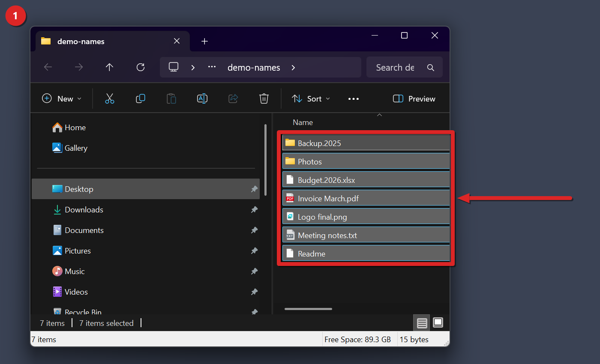
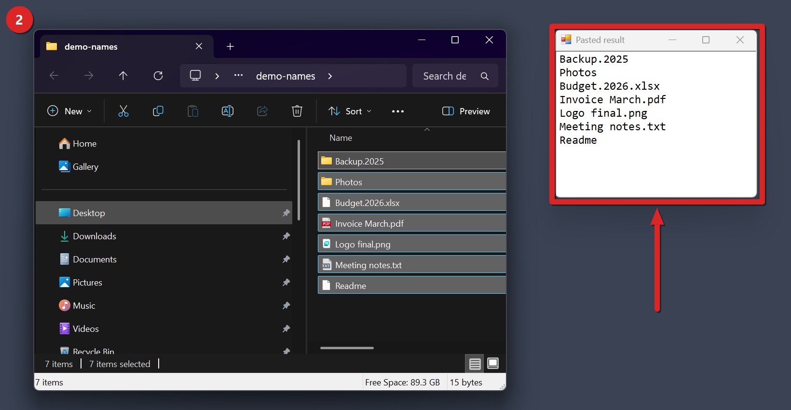
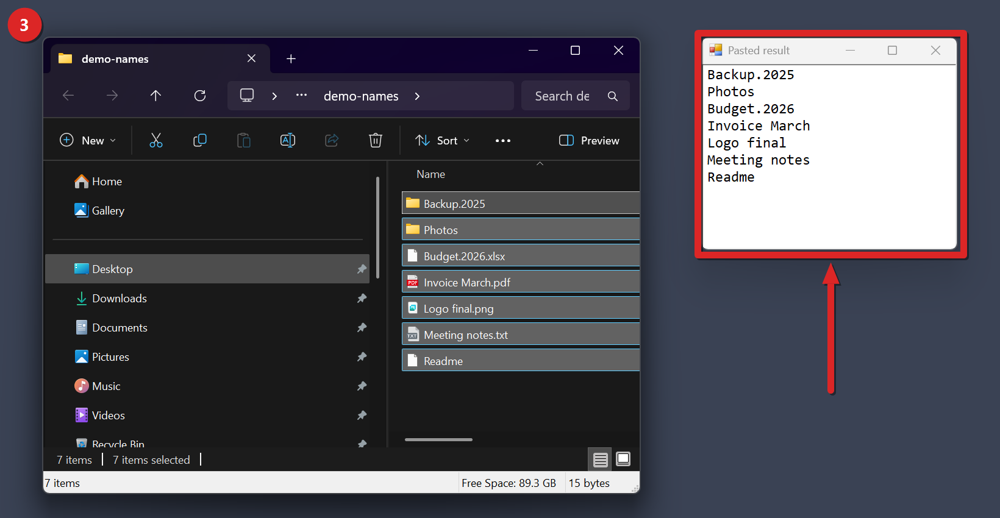
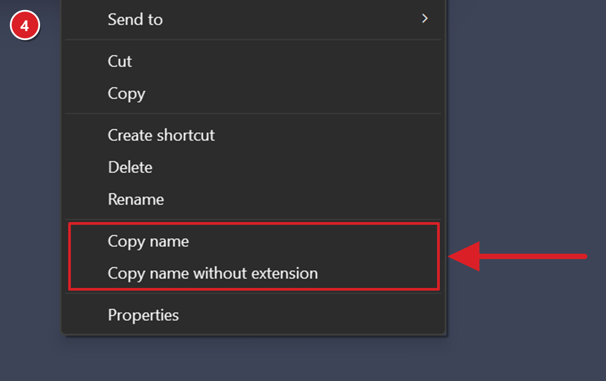

# Bulk Copy File and Folder Names tutorial

This guide sets up the Bulk Copy File and Folder Names mod for Windhawk and goes through every way to use it. When you're done, you can select any mix of files and folders in File Explorer, press one key, and paste their names anywhere as plain text. It takes a few minutes, and most of that is Windhawk compiling the mod. The screenshots come from a real run on a demo folder called demo-names, which holds two folders and five files with made-up names.

## Contents
- [What it fixes](#what-it-fixes)
- [Before you start](#before-you-start)
- [Install](#install)
- [Use it in four steps](#use-it-in-four-steps)
- [How your names come out](#how-your-names-come-out)
- [The right-click entries](#the-right-click-entries)
- [Why Ctrl+Shift+N stops making new folders](#why-ctrlshiftn-stops-making-new-folders)
- [Settings](#settings)
- [How it works under the hood](#how-it-works-under-the-hood)
- [Limits and troubleshooting](#limits-and-troubleshooting)
- [Uninstall](#uninstall)
- [Use at your own risk](#use-at-your-own-risk)

## What it fixes
File Explorer already has Copy as path, on Ctrl+Shift+C. It gives you the full path of each item, wrapped in double quotes. That's fine when a program wants a path. It's no help when you want a list of names for a message or a spreadsheet, because then you have to cut the folder part off every line by hand, and with forty items that's slow and easy to get wrong.

This mod copies the names and nothing else. It doesn't matter if you pick one item or many, files or folders or both. You get one name per line.

## Before you start
You need three things.

- Windows 11. The repo's mods are only tested on Windows 11, and nobody has tried this one on Windows 10.
- Windhawk, from [windhawk.net](https://windhawk.net).
- The file mods/bulk-copy-file-and-folder-names.wh.cpp from this repo.

## Install
The repo describes two ways to add the mod as a local mod. It doesn't cover the Windhawk catalog, so this guide doesn't either.

From the Windhawk app:
1. Open Windhawk and choose Create a new mod.
2. Paste the whole contents of bulk-copy-file-and-folder-names.wh.cpp.
3. Compile and enable the mod.

From a shell you've opened as administrator:

```
windhawk-cli.exe mod install --file mods/bulk-copy-file-and-folder-names.wh.cpp --yes
```

On our machine the CLI is in the C:\Program Files\Windhawk folder. A compile takes about 45 to 60 seconds.

To check that it loaded, look for the mod in your Windhawk list and make sure it's enabled. From the shell, run the command below and look for local@bulk-copy-file-and-folder-names, which is the id a local install gets.

```
windhawk-cli.exe mod list
```

The mod doesn't write a line to the Windhawk log when it starts. It writes one each time it copies, like Copied 7 names with extensions. Step 2 below makes it write that line.

## Use it in four steps
The numbers match the red badges in the corner of each screenshot.

### 1. Select the files and folders
Open the folder in a File Explorer window and select what you want to copy. A mix of files and folders is fine.



Seven items are selected, two folders and five files, and the status bar says 7 items selected.

### 2. Press Ctrl+Shift+N and paste
Keep the File Explorer window in front and press Ctrl+Shift+N. Then paste into any program you like.



The pasted text lists all seven names in full, with extensions like .xlsx and .pdf.

### 3. Press Ctrl+Alt+Shift+N and paste
With the same selection, press Ctrl+Alt+Shift+N and paste again. The files lose their extensions this time, and the folders don't change.



Budget.2026.xlsx comes out as Budget.2026, and the folder Backup.2025 stays as it is.

### 4. Use the right-click menu instead
Hold Shift and right-click the selection, or right-click it and choose Show more options. The classic menu has two new entries, Copy name and Copy name without extension. They do the same as the two keys and follow the same settings.



The two entries sit in their own group right above Properties.

## How your names come out

### Folders
A folder always keeps its whole name, in both modes. The mod checks whether each item is a real folder before it strips anything, so a dot in a folder name is never treated as an extension. That's why Backup.2025 survives step 3.

A zip file is a special case. File Explorer reports a zip as a folder, but it's also a file on disk. The mod only counts an item as a folder when it's a folder and not a file, so Photos.zip comes out as Photos in the without-extension mode. That result comes from reading the code. No recorded test covers a zip file, and the Photos in the screenshots is a plain folder, not a zip.

### Mixed selections
Each item is handled on its own. Folders keep their names, files lose their last extension, and both end up in the same list. Items that aren't files or folders, like drives in This PC, give their internal name instead of the label you see. An item whose name comes back empty is skipped.

### Order
The mod doesn't sort anything. It takes the selection in the order File Explorer hands it over. In the demo run that matched the order on screen, folders first and then files, as you can see in steps 2 and 3. We haven't checked whether it still matches after you sort the view by a different column.

### The real file name, even with extensions hidden
The mod reads each item's parsing name, which is the real name on disk. If you've told File Explorer to hide file extensions, Ctrl+Shift+N still copies them.

### What the without-extension mode does to a name
The mod cuts the name at its last dot. If that dot is the first character, it leaves the name alone, because a name like .gitignore has no extension, it's all name. Folders are never cut.

| Name | Kind | Copied without extension |
| --- | --- | --- |
| Budget.2026.xlsx | file | Budget.2026 |
| archive.tar.gz | file | archive.tar |
| .gitignore | file | .gitignore |
| .config.json | file | .config |
| Readme | file | Readme |
| Photos.zip | zip file, untested | Photos |
| Backup.2025 | folder | Backup.2025 |

So archive.tar.gz loses only .gz. The mod has no list of double extensions and doesn't try to guess one.

### Separator and quotes
Two settings change the text you paste.

The separator goes between names, never after the last one. In these examples Photos is the plain folder from the demo.
- newline puts each name on its own line. This is the default.
- comma puts a comma and a space between names, like Photos, Readme.
- space puts one space between names.

Quote names wraps each name in double quotes, like "Photos" and "Readme". It's off by default. You can combine it with any separator, so comma plus quotes gives you "Photos", "Readme".

The copy replaces whatever was on the clipboard before, as plain Unicode text.

## The right-click entries
The mod doesn't register a shell extension. It hooks the two Windows functions that show popup menus, TrackPopupMenuEx and TrackPopupMenu, inside explorer.exe. Each time File Explorer opens a menu, the mod looks at it and decides whether it's a menu for selected files and folders. If it is, the mod adds its two entries and a separator above the last item, which is Properties on a file menu. When the menu closes, the mod takes its entries out again, so the menu goes back to the way the shell built it.

The entries only show when all of these hold.
- The Right-click menu entries setting is on.
- You right-clicked in the file list of a File Explorer window. The navigation pane, the desktop and Open or Save dialogs don't count.
- At least one item is selected.
- The menu isn't the one you get from empty space in a folder. The mod spots that one because it has a Refresh command.
- The menu isn't the column header menu, the one with check marks for the columns you can show.
- The menu hook installed when the mod loaded. If it didn't, the log says so, as described under Limits and troubleshooting.
- File Explorer opened the menu with the TPM_RETURNCMD flag, so the pick comes back to the code that opened it. The mod leaves any other menu alone.
- The mod finds three command IDs the menu isn't already using, one for each entry and one for the separator.
- All three items go in. If one fails, the mod takes out what it added and shows the menu as it was.

The Windows 11 compact menu, the short one you see first, can't take new entries from a mod. That's why you need Shift+right-click or Show more options.

### Large selections
A file menu usually has a default action, like Open in bold. The column header menu has none, so a missing default could mark the header menu. A comment in the code says File Explorer drops Open when more than 15 files are selected, though. So the mod doesn't reject a menu only for having no default. It rejects it only when it also has check marks or was opened over the column header. That keeps the entries on the menu for big selections. No recorded test covers a selection that large.

## Why Ctrl+Shift+N stops making new folders
Ctrl+Shift+N is also File Explorer's own New folder key. The mod registers its keys as system hotkeys while a File Explorer window is in front. Windows hands a registered hotkey to the program that registered it, and the window in front never gets that key press. So with the mod on and the default keys, Ctrl+Shift+N copies names and no folder appears.

If you use New folder from the keyboard, move the copy key somewhere else. Set Modifiers for copy names with extension to Alt+Shift, for example, and Ctrl+Shift+N goes back to making folders. The keys are released within 100 ms after another app comes to the front, on the mod's next timer check, so other programs keep their own shortcuts.

## Settings
You change these in the mod's Settings tab in Windhawk. The mod picks up new values without a restart of File Explorer.

| Key | Name in Windhawk | Default | Allowed values | Effect |
| --- | --- | --- | --- | --- |
| withExtModifier | Modifiers for copy names with extension | ctrl_shift | ctrl_shift (Ctrl+Shift), ctrl_alt (Ctrl+Alt), ctrl_alt_shift (Ctrl+Alt+Shift), alt_shift (Alt+Shift), win_shift (Win+Shift) | Modifier keys for the copy with extensions |
| withExtKey | Key for copy names with extension | N | One letter A to Z, one digit 0 to 9, or F1 to F24 | Main key for the copy with extensions |
| noExtModifier | Modifiers for copy names without extension | ctrl_alt_shift | ctrl_shift (Ctrl+Shift), ctrl_alt (Ctrl+Alt), ctrl_alt_shift (Ctrl+Alt+Shift), alt_shift (Alt+Shift), win_shift (Win+Shift) | Modifier keys for the copy without extensions |
| noExtKey | Key for copy names without extension | N | One letter A to Z, one digit 0 to 9, or F1 to F24 | Main key for the copy without extensions |
| separator | Separator | newline | newline (New line), comma (Comma), space (Space) | What goes between names. comma adds a space after the comma |
| quoteNames | Put each name in double quotes | off | on, off | Wraps each name in double quotes |
| contextMenu | Right-click menu entries | on | on, off | Adds Copy name and Copy name without extension to the classic menu. The keys work either way |

A few details come straight from the code.
- Letters aren't case sensitive, so n works the same as N.
- A key value the mod can't read, like a word or F25, falls back to N. An unknown modifier value falls back to the default for that key.
- If you hold a hotkey down, the copy doesn't repeat.
- If you give both copies the same key and modifiers, Windows refuses the second one, and the mod logs that it couldn't register that key.

To set a value from an elevated shell, use the same form as the other mods in this repo.

```
windhawk-cli.exe mod settings set local@bulk-copy-file-and-folder-names "'separator=comma'"
```

## How it works under the hood
The mod runs only inside explorer.exe. On load it starts one background thread with a hidden message window.

- A timer on that window checks every 100 ms whether the window in front is a File Explorer window. It registers the two hotkeys when one is and drops them when one isn't.
- When a hotkey fires, the mod finds the active tab of that File Explorer window through the Shell Windows list and asks its folder view for the selection.
- For each selected item it reads the parsing name, strips the extension if you asked for that, and adds the name to a list.
- It joins the list with your separator and quotes and puts the text on the clipboard. If another program holds the clipboard, it tries five times, 20 ms apart, before it gives up and logs an error.
- The menu entries and the hotkeys call the same copy code, so reading the names, the separator, the quotes and the clipboard write are shared. They find the file view in different ways. The hotkeys look up the window in front, and the menu entries use the window that opened the menu.
- A second copy request that arrives while one is still running is dropped.

When you disable the mod, it closes any open menu that carries its entries, releases the hotkeys and stops its thread.

## Limits and troubleshooting
These come from the code and the mod's own readme.

Nothing gets copied when you press the key.
- A File Explorer window has to be in front. The desktop and Open or Save dialogs don't count.
- Something has to be selected. With nothing selected, nothing happens and the clipboard keeps what it had.
- Another program may already own the same key combination. The Windhawk log then shows Could not register the copy-with-extension hotkey or Could not register the copy-without-extension hotkey, with an error number. The mod logs this once per settings load, so after the first time you won't see it again until you change a setting. Pick a different key in the settings.
- If the log shows Could not find the shell view for this window or Could not read the selection from this window, the mod couldn't reach the file list of that window.
- If the log shows Could not open the clipboard, another program held the clipboard through all five tries.
- If the log shows CoInitializeEx failed or Could not create the message window, the mod's background thread didn't start its hidden window. The hotkeys are registered on that window, so they won't work.

The right-click entries don't show.
- You're probably in the compact menu. Use Shift+right-click or Show more options.
- They don't appear on empty space, on the column header, in the navigation pane, on the desktop, or in dialogs.
- Check that Right-click menu entries is on.
- The log line "Could not hook TrackPopupMenuEx, menu entries are off" means the menu hook failed to install. The hotkeys still work. A second line, Could not hook TrackPopupMenu, means the hook on the other menu function failed.

Other limits.
- The menu labels are in English only.
- Drives and other special items give their internal name.
- The mod doesn't change your files or the normal Copy command.

What hasn't been tested. The screenshots come from one run on Windows 11, and the repo has no other recorded live test of this mod. The New folder key clash, selections above 15 items, zip files, drives, sort orders other than by name, and Windows 10 all follow from reading the code. None of them has a recorded test.

## Uninstall
Open Windhawk, find the mod, and disable it or remove it. From an elevated shell:

```
windhawk-cli.exe mod disable local@bulk-copy-file-and-folder-names --yes
windhawk-cli.exe mod remove local@bulk-copy-file-and-folder-names --yes
```

Once the mod is off, its hotkeys are released, so Ctrl+Shift+N makes new folders again.

## Use at your own risk
This mod comes with no warranty of any kind, and you use it at your own risk. The author isn't liable for any damage, data loss, crash, or other harm it causes. It runs inside File Explorer, so test it on your own machine before you rely on it. The full terms are in the [LICENSE](../LICENSE) file.
