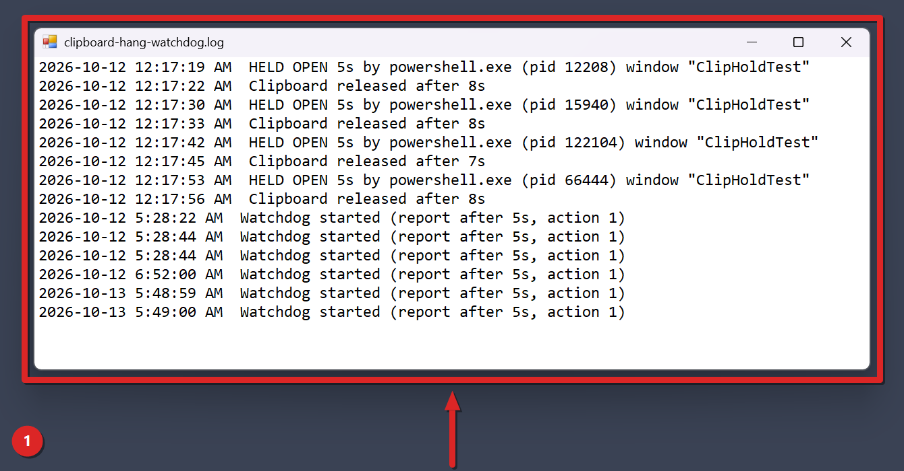

# Clipboard Hang Watchdog

Clipboard Hang Watchdog is a Windhawk mod for Windows 11 that finds the program blocking your clipboard and writes its name to a log. It's for you if copy and paste stop working now and then and you can't tell which app is to blame. It starts in log-only mode, so it won't end anything until you tell it to.

## The problem

Windows lets only one program hold the clipboard open at a time. If a program opens it and never closes it, every other app is locked out. You press Ctrl+C and nothing is copied, or you press Ctrl+V and the app freezes. Sometimes that lasts for many seconds.

There's a second way it goes wrong. The program that owns the copied data can stop responding. Other programs then wait for it when they paste, and Windows waits up to 30 seconds for that data. In both cases Windows doesn't tell you which program is responsible.

## Install

You need [Windhawk](https://windhawk.net) installed first. Then pick one way.

From the Windhawk app:

1. Open Windhawk and choose Create a new mod.
2. Paste the contents of mods/clipboard-hang-watchdog.wh.cpp.
3. Compile and enable the mod.

From an elevated shell (run as administrator):

```
windhawk-cli.exe mod install --file mods/clipboard-hang-watchdog.wh.cpp --yes
```

A compile takes about 45 to 60 seconds on our machine. A locally installed copy gets the ID local@clipboard-hang-watchdog.

### Check that it's loaded

The mod runs inside explorer.exe. When it loads, it writes one line to the Windhawk log and to its own log file:

```
Watchdog started (report after 5s, action 1)
```

The first number is your threshold in seconds. Action 1 means log only and action 2 means log and end the holder. You can also list your mods from an elevated shell and look for local@clipboard-hang-watchdog:

```
windhawk-cli.exe mod list
```

## How you use it

The watchdog runs in the background. There's nothing to click.

1. Install and enable it. Leave the settings at their defaults for now.
2. Use your PC as you normally do.
3. When copy and paste stop working, give it a few seconds. With the default settings a hold is logged once it has lasted 5 seconds.
4. Open the log file in any text editor. It lives here:

```
%LOCALAPPDATA%\clipboard-hang-watchdog.log
```

5. Look for the newest line whose message text starts with HELD OPEN or OWNER NOT RESPONDING. In the file, that text comes right after the date and time. It names the program, its process ID and the title of its window.
6. Once the hang clears, a later line says the clipboard was released or that the owner is responding again.

Each line in the file starts with the date and a 12-hour time, for example 2026-10-16 3:07:42 PM, then two spaces and the message text. The same message text goes to the Windhawk log too.

### What the log file looks like

This screenshot shows the first 14 lines of the real log file on our test PC, opened in a plain text window on a solid backdrop. The four HELD OPEN lines come from the hold test that the README's Status section describes. In that test a window called ClipHoldTest held the clipboard open on purpose. No hang was staged for this guide.



Each HELD OPEN line names powershell.exe, its process ID and the window title ClipHoldTest. The Clipboard released line after it gives the full length of that hold, 7 or 8 seconds. The Watchdog started lines show action 1, which is log only.

These are the messages the mod writes:

| Message text starts with | What it means |
| --- | --- |
| Watchdog started | The mod loaded. It shows the threshold and the action number. |
| HELD OPEN | A window kept the clipboard open past the threshold. You get the seconds, program name, process ID and window title. |
| Clipboard released after | The hold that was logged has ended. You get its total length in seconds. |
| OWNER NOT RESPONDING | The program that owns the clipboard data has stopped responding for longer than the threshold. |
| Clipboard owner responding again | After a reported owner, a later check found no owner that isn't responding. The owner may have recovered, or the clipboard may have a new owner or none, for example after a new copy. |
| Ended | In endHolder mode the mod ended the holding program. The line ends with done or failed. |
| Not ending | The mod left the holder alone, and the line says protected program. That happens when the holder is on the protected list, has process ID 0, or is the explorer.exe the mod runs in. |
| Could not open | Windows didn't let the mod open the holder to end it. The line has the Windows error number. |

### Letting it end the holder

When the mod ends a program, that program's unsaved work is lost. That's why this is off by default. If you accept that, switch the action to endHolder:

```
windhawk-cli.exe mod settings set local@clipboard-hang-watchdog "'action=endHolder'"
```

After that, when a program keeps the clipboard open for killAfterSeconds (15 by default), the mod ends it and logs an Ended line. It won't end anything on the protected list.

## Settings

| Key | Default | Allowed values | Effect |
| --- | --- | --- | --- |
| thresholdSeconds | 5 | Whole seconds, 1 or more. A value under 1 counts as 1. | How long a hold, or an owner that isn't responding, lasts before it's logged. |
| action | logOnly | logOnly or endHolder. Any other value counts as logOnly. | logOnly writes to the log. endHolder writes to the log and ends the program that holds the clipboard open. |
| killAfterSeconds | 15 | Whole seconds. A value lower than thresholdSeconds is raised to match it. | In endHolder mode, how long a hold lasts before the mod ends the program. It has no effect in logOnly mode. |
| maxLogKB | 100 | Whole kilobytes. 0 or less means no limit. | When the log file is bigger than this, the mod renames it to clipboard-hang-watchdog.log.old before its next write and starts a new log. An older .old file is replaced. |
| protectedProcesses | explorer.exe,dwm.exe,csrss.exe,winlogon.exe,svchost.exe,sihost.exe,services.exe,lsass.exe | Program file names, separated by commas. Case and spaces around a name don't matter. | Programs the mod never ends. |

The mod reads its settings again whenever you change them, so you don't need to restart anything.

## How it works under the hood

The mod loads only into explorer.exe. It starts one background thread, and that thread checks the clipboard every 500 ms.

Each check asks Windows two things. The first is which window has the clipboard open, through GetOpenClipboardWindow. The second is which window owns the clipboard data, through GetClipboardOwner, and whether that window has stopped responding, through IsHungAppWindow. The timer for a hold starts the first time the mod sees that window. If a different window takes over, the timer starts again.

To name a program, the mod reads the full path of its process and keeps the file name. If it can't read the path, the name shows as a question mark.

Only the held-open case can lead to ending a program. The mod ends it with TerminateProcess. It never ends process ID 0, the explorer.exe it runs in, or anything on the protected list. An owner that stops responding is only logged, in either mode.

Every line goes to the Windhawk log and is appended to the log file as UTF-8. When the mod unloads, it tells the thread to stop and waits up to 3 seconds for it. It doesn't delete the log file.

## Limits and known gaps

- Windows reports a holder only when it opened the clipboard with a window handle. A program that opened it with no window isn't logged at all, and the mod can't name it.
- An owner of copied data is caught only when Windows marks its window as not responding.
- If the Windows Clipboard User Service (cbdhsvc) is stuck, the mod can't see it.
- The mod checks every 500 ms and counts in whole seconds. A hold shorter than one check can slip past it.
- A program the mod ends loses its unsaved work.
- The log keeps one backup. Each time the log passes the size limit, the old backup is replaced.

## What's tested and what isn't

The README's Status section records these tests on Windows 11 build 26300 with a single monitor. The clipboard watchdog was tested for hold detection and for ending a holder. The log trim, which moves an over-limit log to a .old file, passed a test with an 8-run overflow.

The repo records no separate test of the check for an owner that stops responding. Windows 10 hasn't been tried.

## Troubleshooting

My clipboard hangs and the log shows nothing. That points at the Clipboard User Service or at a holder that opened the clipboard with no window. The mod covers neither case. The mod's own notes say signing out and back in resets that service, and that the signs of a stuck service are a frozen Win+V history and new copies that don't appear.

There's no log file. The mod writes its first line as soon as it loads, so a missing file usually means it isn't running. Check that it's enabled. The file path comes from the LOCALAPPDATA variable, and if Windows can't give the mod that path, it writes to the Windhawk log only.

The mod didn't end the program. Check that action is endHolder and that the hold lasted at least killAfterSeconds. Check the protected list too. A Not ending line means the program is on it, and an owner that stops responding is never ended.

The log says Could not open or Ended with failed. Windows refused the request to end that program. The Could not open line carries the error number Windows gave.

The program name is a question mark. The mod couldn't read that program's file path. The process ID in the same line still points to it.

## Uninstall

Open Windhawk, find the mod, and disable or delete it. From an elevated shell you can run one of these:

```
windhawk-cli.exe mod disable local@clipboard-hang-watchdog --yes
windhawk-cli.exe mod remove local@clipboard-hang-watchdog --yes
```

The mod doesn't delete its log file or the .old backup. Both stay in your local app data folder.

## Use at your own risk

This mod comes with no warranty of any kind, and you use it at your own risk. The author isn't liable for any damage, data loss, crash, or other harm it causes. The endHolder setting ends programs, and their unsaved work is lost. The full terms are in the [LICENSE](../LICENSE) file.
