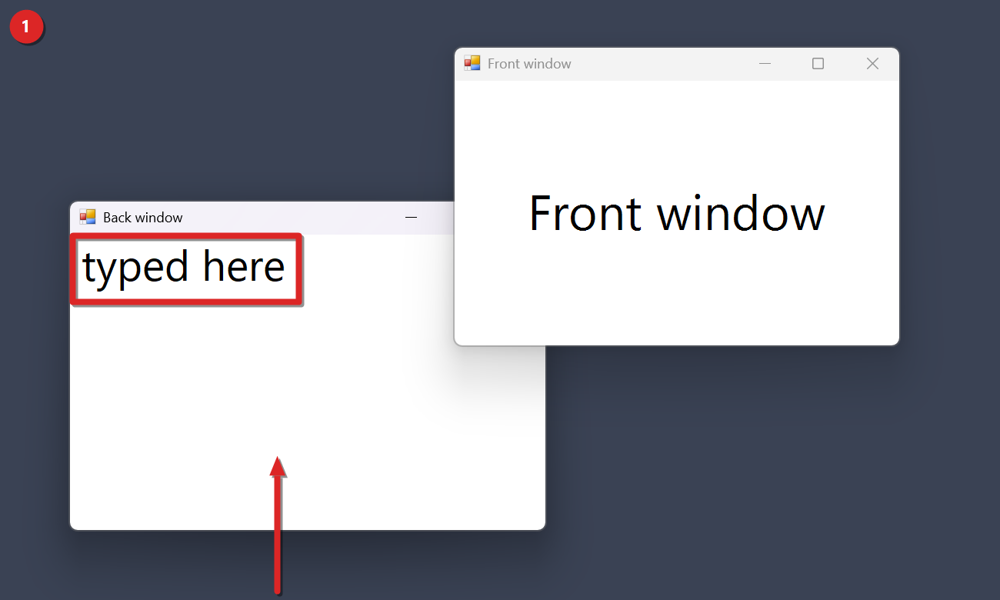

# Focus Follows Mouse

Focus Follows Mouse is a Windhawk mod that gives keyboard focus to the window under your pointer on Windows 11, with no click. It's for you if you've used a Linux desktop that works this way, or if you often type into one window while you read another. By default it doesn't bring the window to the front, so the window you're reading stays on top while you type in the one underneath.

## The problem

On Windows, the window under your pointer doesn't get keyboard focus until you click it. The click also brings that window to the front, and it can cover the window you were reading.

Windows 11 has a weak version of hover focus hidden in its Accessibility settings. It always pulls the hovered window to the front. This mod turns on that same built-in Windows feature and gives you control over the delay and over whether the window comes to the front.

## Install

You need [Windhawk](https://windhawk.net) installed first. Then pick one way.

From the Windhawk app:

1. Open Windhawk and choose Create a new mod.
2. Paste the contents of mods/focus-follows-mouse.wh.cpp.
3. Compile and enable the mod.

From an elevated shell (run as administrator):

```
windhawk-cli.exe mod install --file mods/focus-follows-mouse.wh.cpp --yes
```

A compile takes about 45 to 60 seconds on our machine. A locally installed copy gets the ID local@focus-follows-mouse.

### Check that it's loaded

The mod runs inside explorer.exe. When it loads with the mod turned on, it writes two lines to the Windhawk log. The first one starts with Saved original and records the values Windows had before. The numbers in it depend on your PC. The second one records what the mod set, and with the defaults it reads:

```
Applied: delay=300 raise=0
```

You can also list your mods from an elevated shell and look for local@focus-follows-mouse:

```
windhawk-cli.exe mod list
```

## How you use it

1. Install and enable the mod.
2. Open two windows that overlap a little, for example a text editor and a browser.
3. Click the browser so it's in front.
4. Move the pointer onto the part of the editor you can still see and leave it there for a moment. With the defaults that's 300 ms.
5. Type a few letters. They should go into the editor, and the browser should stay in front.
6. If you'd rather have the hovered window come to the front too, turn on raiseWindow.

To change a setting from the shell, pass the key and value like this:

```
windhawk-cli.exe mod settings set local@focus-follows-mouse "'delayMs=500'"
```

## See it work

This screenshot comes from one live run on Windows 11 build 26300 with the default settings, delayMs 300 and raiseWindow off. The run opened two plain test windows on a solid backdrop, called Front window and Back window. Front window was made the active window first. Then the pointer moved onto the part of Back window you can see and stayed there for 1.5 seconds, with no click. Then the run typed the words typed here.



The words went into Back window. Front window still covers Back window's top right corner, so the hover gave Back window focus and Back window didn't come to the front. Back window's title text is dark and Front window's is gray, which is how Windows 11 marks the active window. The red arrow marks the spot where the pointer rested. The screenshot doesn't show the pointer itself.

## Settings

| Key | Default | Allowed values | Effect |
| --- | --- | --- | --- |
| enabled | on | On or off. | On turns hover focus on. Off puts back the Windows values the mod saved the first time it applied its values with enabled on. |
| delayMs | 300 | 0 to 5000 milliseconds. A value below 0 counts as 0 and a value above 5000 counts as 5000. | How long the pointer has to rest on a window before it gets focus. |
| raiseWindow | off | On or off. | On also brings the focused window to the front. Off gives it focus and leaves it where it is in the stack. |

The mod applies a changed setting as soon as you save it.

## How it works under the hood

The mod loads only into explorer.exe, but it doesn't hook anything there. It changes three Windows system settings through SystemParametersInfo:

- active window tracking, which is the hover focus switch itself
- the tracking delay, set from delayMs
- the raise-on-hover flag, set from raiseWindow

These are Windows system settings, not Explorer settings, which is why the mod can live in explorer.exe. We haven't tested whether the change reaches every app's windows.

The first time it applies its values, the mod reads and saves the three values Windows had. When you turn enabled off, or when the mod unloads, it writes those saved values back. It doesn't write to the registry. Windows resets these values at the next sign in, and the mod sets them again each time Explorer starts.

## Limits and known gaps

- If you change these options in Windows Settings while the mod runs, the mod keeps its own values until you change a mod setting or reload it.
- When the mod unloads, it puts back the values it saved the first time it applied its values with enabled on. If enabled was never on, it saved nothing and puts nothing back. A change you made in Windows Settings in between is replaced by those older values.
- Windows decides which windows count. Menus and the taskbar behave as Windows decides.
- If the mod can't read the current values when it first applies its own, it doesn't change anything.

## What's tested and what isn't

The README's Status section records one live run of focus follows mouse on Windows 11 build 26300 with a single monitor, the one in the screenshot above. A hover with no click gave focus to a window behind another one. The typed text went into it, and Windows still reported the front window above it in the stack.

That run used two test windows, the default delay of 300 ms and raiseWindow off. raiseWindow on, other delays, real apps such as a browser, and the restore of the saved values when the mod unloads haven't been tested. The repo also says the mods are tested only on Windows 11, and Windows 10 hasn't been tried.

## Troubleshooting

Focus doesn't move when I hover. Look in the Windhawk log for the Applied line. If you see Could not read the current hover focus settings instead, the mod couldn't read the Windows values and it left everything as it was. Check that enabled is on, too.

The window still jumps to the front. Check that raiseWindow is off. The mod writes it into the Applied line as raise=0 or raise=1.

Focus moves too fast or too slow. Change delayMs. Anything past 5000 counts as 5000.

I changed hover focus in Windows Settings and the mod changed it back. That's expected while the mod runs. It keeps its own values until you change a mod setting or reload it.

## Uninstall

Open Windhawk, find the mod, and disable or delete it. From an elevated shell you can run one of these:

```
windhawk-cli.exe mod disable local@focus-follows-mouse --yes
windhawk-cli.exe mod remove local@focus-follows-mouse --yes
```

When the mod unloads, it writes the saved Windows values back and logs Restored original hover focus settings.

## Use at your own risk

This mod comes with no warranty of any kind, and you use it at your own risk. The author isn't liable for any damage, data loss, crash, or other harm it causes. The full terms are in the [LICENSE](../LICENSE) file.
