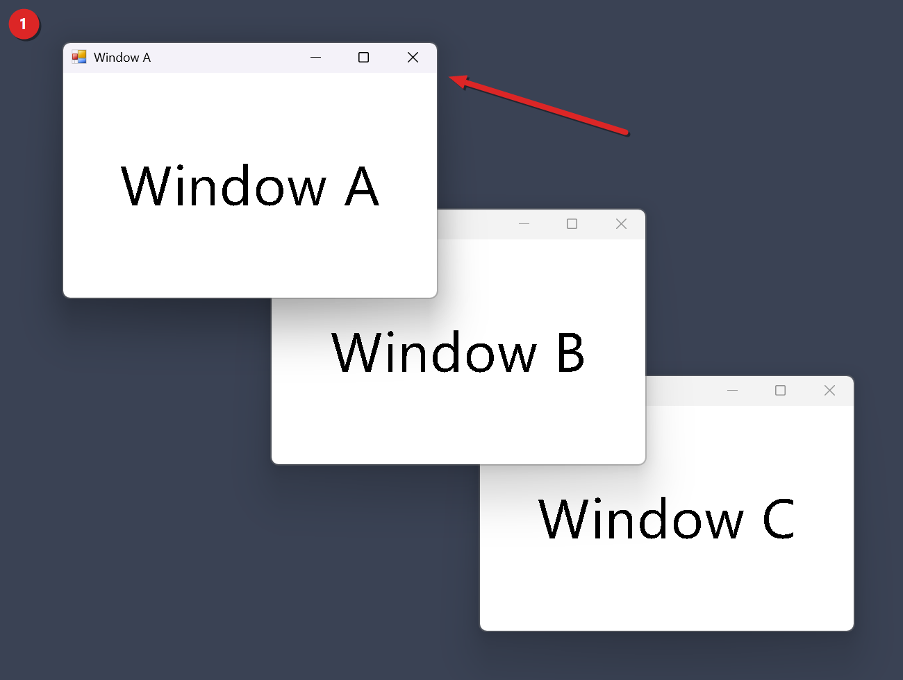
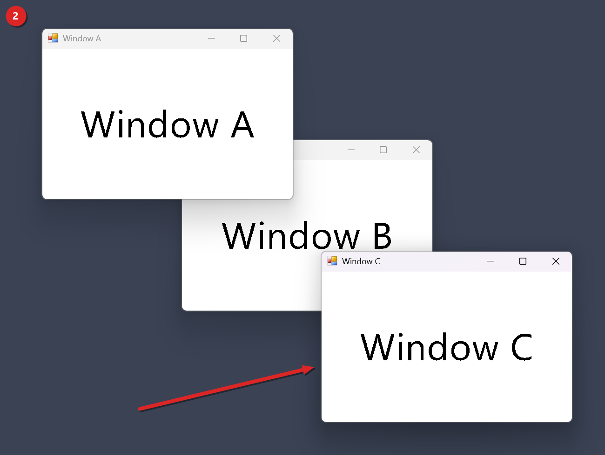
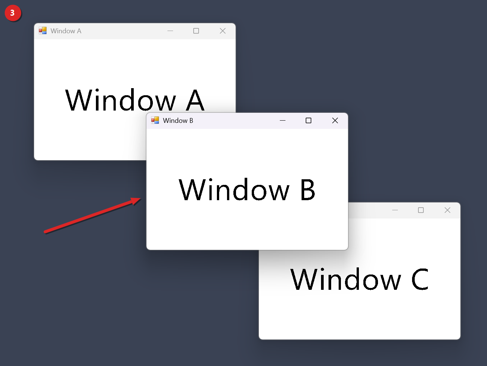

# Same-App Window Cycler tutorial

This guide sets up the Same-App Window Cycler mod for Windhawk and walks you through it with three test windows. When you're done, you can press Alt and the backtick key to move to the next window of the app you're already in, the way Cmd+Backtick works on a Mac. It's for people who keep several windows of one program open, like a handful of browser windows or two Notepad files, and get tired of hunting for them in Alt+Tab. The screenshots come from one live run on Windows 11 build 26300 with the default settings. That run used three plain test windows of one program, called Window A, Window B and Window C, on a solid backdrop. They aren't Notepad windows.

In this guide, Backtick means the key above Tab on a US keyboard. The mod asks Windows for that key by its code, VK_OEM_3. We haven't checked where that key sits on other keyboard layouts.

## Contents
- [What it fixes](#what-it-fixes)
- [Before you start](#before-you-start)
- [Install](#install)
- [Use it in four steps](#use-it-in-four-steps)
- [The result and the settings behind it](#the-result-and-the-settings-behind-it)
- [Which windows count](#which-windows-count)
- [Settings](#settings)
- [How it works under the hood](#how-it-works-under-the-hood)
- [Limits and troubleshooting](#limits-and-troubleshooting)
- [What's tested and what isn't](#whats-tested-and-what-isnt)
- [Wrap-up](#wrap-up)
- [Uninstall](#uninstall)
- [Use at your own risk](#use-at-your-own-risk)

## What it fixes
Alt+Tab shows every window from every app in one row. Say you've got six browser windows and a code editor open. To reach the right browser window you press Tab several times and read each thumbnail, and the code editor sits in the middle of the row the whole time. Windows has no key that stays inside one app.

This mod adds one. Alt+Backtick moves between the windows of the program in front, and windows from other programs don't take part.

## Before you start
You need three things.

- Windows 11. The repo's mods are only tested on Windows 11, and nobody has tried this one on Windows 10.
- Windhawk, from [windhawk.net](https://windhawk.net).
- The file mods/same-app-window-cycler.wh.cpp from this repo.

## Install
The repo describes two ways to add the mod as a local mod.

From the Windhawk app:
1. Open Windhawk and choose Create a new mod.
2. Paste the whole contents of same-app-window-cycler.wh.cpp.
3. Compile and enable the mod.

From a shell you've opened as administrator:

```
windhawk-cli.exe mod install --file mods/same-app-window-cycler.wh.cpp --yes
```

A compile takes about 45 to 60 seconds on our machine.

To check that it loaded, list your mods and look for local@same-app-window-cycler, which is the id a local install gets.

```
windhawk-cli.exe mod list
```

The mod doesn't write a line to the Windhawk log when it starts, unless it can't claim its keys. Then the log says Could not register the next-window hotkey or Could not register the previous-window hotkey, with an error number after it. Each switch writes a line like Cycling 3 windows forward. Step 2 below makes it write that line.

## Use it in four steps
The numbers match the red badges in the corner of each screenshot. Each arrow points at the window that's in front.

### 1. Open three windows of one program and click the first one
Open two or more windows of one program and click one of them so it's in front. Two windows are enough for the mod. Three show the order better.



Window A is in front, Window B is behind it, and Window C is at the back.

The gotcha is a window with no taskbar button. Some apps give a window like that a hidden owner window, and the mod leaves out any window that has an owner. Our first test hit this. Test windows with no taskbar button weren't cycled, and the same windows with a taskbar button were.

### 2. Press Alt+Backtick
Hold Alt and press Backtick once. The window that sits furthest back comes to the front.



Window C is in front now, and Window A's title text is gray because it isn't the active window anymore.

The gotcha is holding the keys down. The switch doesn't repeat, because the mod registers both keys with Windows' no-repeat flag. You get one switch per press.

### 3. Press Alt+Backtick again
Press it a second time. Window B was furthest back after step 2, so it comes to the front.



Window B is in front, and Window A's title text is still gray.

With two windows, each press takes you back to the other one. With three or more, each press brings up the window furthest back, so you go round all of them in turn. The gotcha is an app with only one window that counts. Then nothing happens and the log stays quiet.

### 4. Press Alt+Shift+Backtick
Add Shift to go the other way. The mod's own notes describe it like that.

No screenshot for this step. The live run stopped after step 3 and never pressed this key.

The gotcha is what the code does with three or more windows. It always brings the second window in the stack to the front. With two windows that's the same as going forward. With three or more, pressing it over and over flips between the same two windows instead of walking the whole list backward. That comes from reading the code, and no recorded test covers it.

## The result and the settings behind it
During the run, the stack order was read back from Windows after each step.

| After | Order, front to back |
| --- | --- |
| Step 1 | A, B, C |
| Step 2, one press | C, A, B |
| Step 3, two presses | B, C, A |

That's the order the code describes. The run stopped there, so it didn't record a third press.

The mod ran with its defaults: modifier alt, includeMinimized on and currentDesktopOnly on. All three windows were on one virtual desktop, and none were minimized.

## Which windows count
Only windows from the same program file count. The mod compares the full path of the program file, and letter case doesn't matter. Two Notepad windows cycle. Notepad and Word don't.

A window counts only if all of these hold.

- It has no owner window, so dialogs that belong to a main window are left out.
- It isn't a tool window, unless it's also marked as an app window.
- Its title isn't empty.
- It's visible, or it's minimized and Include minimized windows is on.
- It isn't cloaked by the desktop window manager. A window on another virtual desktop is cloaked, and it's let through only when Current virtual desktop only is off. Other cloaked windows are always left out.

If a window you land on is minimized, it's restored and brought to the front. That happens only while Include minimized windows is on, which it is by default.

## Settings
You'll find these in the mod's Settings tab in Windhawk. The keys and defaults come from the settings block in the mod file.

| Key | Name in Windhawk | Default | Allowed values | Effect |
| --- | --- | --- | --- | --- |
| modifier | Modifier key | alt | alt (Alt), ctrl_alt (Ctrl+Alt), win (Win) | The key you hold with Backtick. The previous-window shortcut adds Shift to whichever one you pick. |
| includeMinimized | Include minimized windows | on | on, off | When on, minimized windows are part of the cycle and get restored when you land on them. When off, they're left out. |
| currentDesktopOnly | Current virtual desktop only | on | on, off | When on, windows on other virtual desktops are left out. When off, they're kept in the list. |

A change to the modifier takes effect right away. The mod drops its old keys and registers the new ones without a restart. If you pick Ctrl+Alt or Win, the steps above work the same with that modifier in place of Alt, and Shift still adds the other direction.

To set a value from an elevated shell, use the form the repo's README gives.

```
windhawk-cli.exe mod settings set local@same-app-window-cycler "'modifier=ctrl_alt'"
```

## How it works under the hood
The mod runs inside explorer.exe and nowhere else. It doesn't hook any functions. When it loads, it starts one thread of its own, creates a hidden message-only window on that thread, and registers two system-wide hotkeys with RegisterHotKey. Hotkey 1 is the modifier plus VK_OEM_3. Hotkey 2 adds Shift.

When you press a hotkey, the mod reads the front window and finds the full path of the program file that owns it. Then it walks every top-level window with EnumWindows and keeps the ones that come from the same file path and pass the checks in Which windows count.

EnumWindows returns windows from the top of the stack down, so the front window comes first. Forward picks the last window in that list, which is the one furthest back. Backward picks the second one. The mod restores the target if it's minimized, briefly attaches its input to the thread of the current front window, and calls BringWindowToTop and SetForegroundWindow. It writes one line to the Windhawk log each time it switches.

When you disable or remove the mod, it tells its thread to quit. The thread destroys the hidden window, which unregisters both hotkeys, and then the window class is removed. The mod waits up to 3 seconds for the thread to finish. If it hasn't finished by then, the mod closes its handle to the thread and unloads anyway. We haven't tested that case.

## Limits and troubleshooting
These come from the code and the mod's own readme.

Limits.
- Store apps share one frame host process, ApplicationFrameHost.exe, so they'd all look like one app. The mod does nothing when one of them is in front.
- The mod's own notes say a window that runs as administrator can't be switched to from Explorer.
- Windows only count as the same app when they come from the same program file at the same path. Two copies of one program installed in two folders won't cycle together.
- When File Explorer is in front, the mod only acts if that Explorer window itself counts as a normal window. The code has no special check for the desktop or the taskbar, and we haven't tested what it does when one of them is in front.
- With Current virtual desktop only off, windows on other desktops are added to the cycle. We haven't tested what Windows does when the mod brings one of them to the front.
- The key is fixed in code as VK_OEM_3. Only the modifier can be changed in the settings.

Nothing happens when you press the keys. Check the Windhawk log first. A line that starts with Could not register means Windows refused the key combination, and the error number after it tells you why. One possible cause, which we haven't checked, is another program that already holds the same combination. Pick a different modifier in the settings and try again.

Nothing happens, and the log has no error. The app in front may have only one window that counts. Untitled windows, dialogs with an owner, tool windows and hidden windows don't count. If it's a Store app, the mod skips it on purpose.

A window with no taskbar button gets skipped. It probably has a hidden owner window, as step 1 describes.

A minimized window gets skipped. Include minimized windows is probably off. Turn it back on.

A window on another virtual desktop never shows up. That's the default. If you turn off Current virtual desktop only, those windows join the cycle, but that path hasn't been tested.

## What's tested and what isn't
The README's Status section records one live run of the window cycler on Windows 11 build 26300 with a single monitor. Two presses of Alt+Backtick on three test windows of one program went A to C to B, which is the order the code describes. The screenshots in steps 1 to 3 come from that run.

Nothing else has a recorded test. That covers Alt+Shift+Backtick, minimized windows, virtual desktops, the Ctrl+Alt and Win modifiers, Store apps, Notepad and other real apps. The rest of this guide comes from reading the code and the repo's text. The repo hasn't tried any of the mods on Windows 10.

## Wrap-up
You installed the mod, put three windows of one program on screen, and pressed Alt+Backtick twice. The window furthest back came to the front each time, and the code writes one Cycling line to the log per switch. Alt+Shift+Backtick is there too, with the two-window flip described in step 4.

## Uninstall
Open Windhawk, find the mod, and disable it or remove it. From an elevated shell:

```
windhawk-cli.exe mod disable local@same-app-window-cycler --yes
windhawk-cli.exe mod remove local@same-app-window-cycler --yes
```

Both hotkeys are released as soon as the mod unloads.

## Use at your own risk
This mod comes with no warranty of any kind, and you use it at your own risk. The author isn't liable for any damage, data loss, crash or other harm it causes. It runs inside Windows apps, so test it on your own machine before you rely on it. The full terms are in the [LICENSE](../LICENSE) file.
