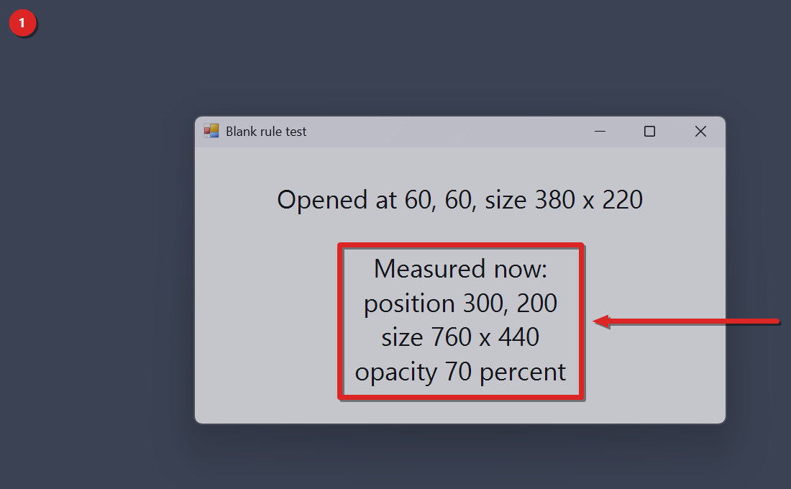

# Window Rules tutorial

This guide sets up the Window Rules mod for Windhawk and walks you through your first rule. When you're done, an app you pick opens at the same spot and size every time, and it can stay on top or be a little see-through if you ask for that. You write a rule for a program, and the mod applies it the first time each of that program's windows appears. The screenshot comes from a real test on Windows 11 build 26300 with one monitor. It used a plain test window from powershell.exe called Blank rule test.

## Contents
- [What it fixes](#what-it-fixes)
- [Before you start](#before-you-start)
- [Install](#install)
- [Write your first rule](#write-your-first-rule)
- [Use it in three steps](#use-it-in-three-steps)
- [The result and the settings behind it](#the-result-and-the-settings-behind-it)
- [The rule fields](#the-rule-fields)
- [When the window moves](#when-the-window-moves)
- [A worked example](#a-worked-example)
- [More than one rule](#more-than-one-rule)
- [Settings](#settings)
- [How it works under the hood](#how-it-works-under-the-hood)
- [Limits and troubleshooting](#limits-and-troubleshooting)
- [What's tested and what isn't](#whats-tested-and-what-isnt)
- [Wrap-up](#wrap-up)
- [Uninstall](#uninstall)
- [Use at your own risk](#use-at-your-own-risk)

## What it fixes
Some apps open in a different place and at a different size every time. Others always open on the wrong monitor, or right on top of the window you're working in. You move the window, you resize it, and the next day you do it again. Windows doesn't let you pin an app to a place or a size, and it has no setting to keep one app above the rest. KDE has had per-app window rules for a long time.

This mod adds them. A rule can set a window's position, size, monitor, maximize, always on top and opacity.

## Before you start
You need three things.

- Windows 11. The repo's mods are only tested on Windows 11, and nobody has tried this one on Windows 10.
- Windhawk, from [windhawk.net](https://windhawk.net).
- The file mods/window-rules.wh.cpp from this repo.
## Install
The repo describes two ways to add the mod as a local mod.

From the Windhawk app:
1. Open Windhawk and choose Create a new mod.
2. Paste the whole contents of window-rules.wh.cpp.
3. Compile and enable the mod.

From a shell you've opened as administrator:

```
windhawk-cli.exe mod install --file mods/window-rules.wh.cpp --yes
```

A compile takes about 45 to 60 seconds on our machine.

To check that it loaded, list your mods and look for local@window-rules, which is the id a local install gets.

```
windhawk-cli.exe mod list
```

The mod ships with one blank rule, so it does nothing until you fill a rule in. It doesn't write a line to the log when it loads.

## Write your first rule
You do this once per app, in the mod's Settings tab in Windhawk.

1. Open the mod's settings in Windhawk.
2. Under Rules, fill in the blank rule the mod ships with, or add a new rule below it. Both work, because the mod skips blank rules.
3. Type the program file name in process, for example notepad.exe.
4. Fill in the fields you want and leave the rest at 0 or off. The fields are listed in The rule fields, further down.
5. Save the settings.

There's no screenshot of the settings screen. The test rules were set from the shell with windhawk-cli, so Windhawk's own window was never captured.

The gotcha here is the process name. It has to be the file name with .exe at the end. A folder path won't match, and neither will the name the Start menu shows.

## Use it in three steps
The numbers match the red badge in the corner of the screenshot.

### 1. Open a window that the rule matches
Close the app if it's already open, then start it again. The rule is applied the first time the new window shows itself.



The test window opened at 60, 60 with a size of 380 by 220, and it measured 300, 200 with a size of 760 by 440 and opacity 70 percent once it was open.

The window wrote those numbers into its own body. It read its position, size and opacity back from Windows after it opened. It looks gray because the dark backdrop shows through it at 70 percent.

The gotcha is a window that's already open. Rules only apply when a window first appears, so a window you had open before you saved doesn't move.

### 2. Check the Windhawk log
Look in the Windhawk log while the mod's Log applied rules setting is on. It's on by default. Each time a rule is applied, the log gets a line like this one, with the window's handle at the end.

```
[ShowWindow] applied a rule to window
```

The part in brackets names the call that showed the window. It's ShowWindow, SetWindowPos or CreateWindowExW.

No screenshot for this step. The test read the result from the window itself and didn't capture the Windhawk log.

The gotcha is what the line means. It says a rule matched the window. It doesn't say anything changed. A rule with only a process, or an opacity on a window that's already layered, matches and changes nothing.

### 3. Change the rule, then reopen the app
Edit a field and save. The mod reads the rules again as soon as the settings change. Then close the app and start it again to see the new values.

No screenshot for this step. No capture was made for it, and a still of the reopened window would only repeat step 1.

The gotcha is that the mod checks each window once. If you move a window by hand afterward, it stays where you put it until you close and reopen it.

## The result and the settings behind it
The test in step 1 checked version 0.1.1, which skips a blank rule and reads on. Rule 0 was left fully blank. Rule 1 was the real rule.

| Field | Rule 0 | Rule 1 |
| --- | --- | --- |
| process | empty | powershell.exe |
| title | empty | Blank rule test |
| monitor | 0 | 0 |
| x | 0 | 300 |
| y | 0 | 200 |
| width | 0 | 760 |
| height | 0 | 440 |
| maximize | off | off |
| alwaysOnTop | off | off |
| opacity | 0 | 70 |

The window ended up at 300, 200 with a size of 760 by 440 and an opacity of 70 percent, which is what rule 1 asked for. So rule 1 was applied even with a blank rule above it. Windows reported the window as layered with an alpha of 178, and 178 is 70 percent of 255 once the mod drops the fraction.

## The rule fields
Each rule has ten fields. These are the exact keys from the mod's settings block. The block gives the rule fields no display names of their own.

| Field | Type | Default | What it does |
| --- | --- | --- | --- |
| process | text | empty | The program file name, for example notepad.exe. Required. It's matched against the file name of the running program, without its folder, and letter case doesn't matter. Include the .exe part. |
| title | text | empty | Optional. Text the window title must contain. Case doesn't matter. Leave it empty and the rule matches any window of that program. |
| monitor | number | 0 | 1 for the first monitor, 2 for the second, and so on. 0 keeps the monitor the window is on. A number with no monitor behind it also falls back to the window's own monitor. |
| x | number | 0 | Pixels from the left edge of the monitor's work area. |
| y | number | 0 | Pixels from the top edge of the monitor's work area. |
| width | number | 0 | Width in pixels. 0 keeps the window's own width. |
| height | number | 0 | Height in pixels. 0 keeps the window's own height. |
| maximize | on or off | off | When on, the window is maximized after the other fields are applied. |
| alwaysOnTop | on or off | off | When on, the window is kept above windows that aren't set to stay on top. |
| opacity | number | 0 | 10 to 100 percent. Any other value, 0 included, leaves the opacity alone. |

The work area is the part of the monitor the taskbar doesn't cover.

## When the window moves
The mod moves a window only if the rule sets a monitor above 0, an x or y that isn't 0, or a width or height above 0. If it does move the window, x and y are always used as offsets from the top left corner of the work area. So an x and y of 0 put the window right in that corner. The mod's own readme says 0 leaves the size alone, and that's true. For x and y it's only true when nothing else in the rule asks for a move.

Before the move, the mod fits the window inside the work area.

- A width or height bigger than the work area is cut down to the work area.
- If the window would run past the right or bottom edge, it's pushed back in.
- A negative x or y is moved up to the left or top edge.

A rule can't place a window off screen.

## A worked example
Say you want Notepad windows with notes in the title to open 100 pixels from the left, 80 pixels from the top, at 900 by 700, kept on top and a little see-through. Here's that rule as the first item of the rules list, in the same nested shape the mod's settings block uses for its default rule.

```
- rules:
  - - process: notepad.exe
    - title: notes
    - monitor: 0
    - x: 100
    - y: 80
    - width: 900
    - height: 700
    - maximize: false
    - alwaysOnTop: true
    - opacity: 90
```

In the Windhawk settings screen you type the same values into the fields of one rule. This example hasn't been run. It follows from the code.

- process notepad.exe limits the rule to Notepad. The mod loads this rule only inside notepad.exe.
- title notes means a Notepad window only matches if its title contains the text notes anywhere, in any letter case. Notes.txt matches, and so does keynotes.txt. Untitled doesn't.
- monitor 0 keeps the window on whichever monitor it opened on.
- x 100 and y 80 put the top left corner 100 pixels right of and 80 pixels below the corner of that monitor's work area.
- width 900 and height 700 set the size. On a small screen, the size is cut down to fit the work area.
- maximize false leaves the window at that size.
- alwaysOnTop true keeps it above your other windows.
- opacity 90 makes it 90 percent opaque, so a little of what's behind it shows through.

## More than one rule
The mod reads up to 200 rules. For each program it keeps only the rules whose process matches it, in the order you wrote them. When a window opens, the first of those rules that matches its title wins, and the rest are ignored. A rule without a title matches every window of its program, so a rule for the same program below it never gets a turn. That's why a rule with a title has to sit above a rule without one.

A rule with an empty process does nothing, so the mod skips it and reads on. That's true of the blank rule the mod ships with, too. You can leave it blank and put your rules below it.

Windhawk doesn't tell a mod how long a list is. A rule past the end of the list reads as blank, just like a blank rule you added. So the mod stops after 10 fully blank rules in a row. A fully blank rule has an empty process and title, every number at 0, and maximize and alwaysOnTop off. With 10 or more in a row, the mod doesn't read the rules below them.

A rule that has only a process and nothing else matches, but it doesn't change anything.

## Settings
You'll find these in the mod's Settings tab in Windhawk. The keys and defaults come from the settings block in the mod file.

| Key | Name in Windhawk | Default | Allowed values | Effect |
| --- | --- | --- | --- | --- |
| enabled | Enable rules | on | on, off | Turns all rules on or off. When it's off, no rule is applied. |
| logRules | Log applied rules | on | on, off | Writes a line to the Windhawk log each time a rule is applied to a window. |
| rules | Rules | one empty rule | a list of rules, up to 200 are read | The rules themselves. See the rule fields above. |

Changes take effect for windows that open after you save.

## How it works under the hood
The mod runs inside every process except File Explorer and core system processes. The excluded ones are explorer.exe, csrss.exe, dwm.exe, winlogon.exe, LogonUI.exe, fontdrvhost.exe, sihost.exe and ShellHost.exe.

When it loads inside a program, it reads that program's file name and keeps only the rules for it. Then it hooks three functions with Windhawk.

- ShowWindow, when a window is shown with one of these commands: SW_SHOW, SW_SHOWNORMAL, SW_SHOWNA, SW_SHOWNOACTIVATE, SW_RESTORE or SW_SHOWDEFAULT.
- SetWindowPos, when the call carries SWP_SHOWWINDOW.
- CreateWindowExW, when the new window has WS_VISIBLE and no parent.

Each hook calls the original function first and then checks the window. A window is a candidate only if it's a top-level window with a caption, and isn't a tool window or a window that can't be activated. The mod remembers each candidate it has seen, so it checks a window once. Then it reads the window title, finds the first matching rule and applies it in this order: the move and resize with SetWindowPos, always on top with HWND_TOPMOST, opacity as a layered window with SetLayeredWindowAttributes, and last the maximize with ShowWindow.

The mod has no unload step of its own. When you disable it, Windhawk removes the hooks, and windows keep whatever the rules already set.

## Limits and troubleshooting
These come from the code and the mod's own readme.

Limits.
- Rules apply once, when a window first appears. If you move the window afterward, it stays where you put it.
- The title is read at that first moment. If an app sets its real title later, a rule with a title may not match. The mod has already marked the window as seen, so it won't try again.
- A window that sets its own transparency keeps it. The opacity field skips any window that's already layered.
- The opacity field doesn't apply 1 to 9 or anything above 100.
- Monitor numbers follow the order Windows lists the displays in. The repo hasn't checked that this order matches the numbers in Display settings.
- Only the first 511 characters of a window title are compared.
- The mod's own notes say windows that run as administrator can't be changed by a normal process.
- File Explorer and the core system processes listed above are excluded for stability. You can add more @exclude lines in the mod's source if you want it to skip other programs.
- After the mod has seen more than 2048 windows inside one program, it clears its list of seen windows. A window that shows itself again after that can get its rule a second time.

A rule doesn't apply. Check the process name first. It must be the file name of the program with .exe at the end. Then check that Enable rules is on. If the rule has a title, check that the window's title contains that text when the window first opens.

You changed a rule and the open window didn't move. Rules only apply when a window first appears. Close the app and open it again.

The window went to the top left corner. Your rule sets a width, a height or a monitor, and x and y are 0. Whenever the window moves, x and y count from the corner of the work area. Set them to the offset you want.

The window isn't where you asked. The mod fits every window inside the work area, so a size or offset that would run past the edge gets pulled back in.

The log says a rule was applied but nothing changed. That line means a rule matched the window. A rule with only a process, or with opacity on a window that's already layered, matches without changing anything.

Opacity doesn't change. The value has to be between 10 and 100, and the window can't already be a layered window.

## What's tested and what isn't
The README's Status section records two live tests, both on Windows 11 build 26300 with a single monitor.

- A check on a plain test window. One rule matched the window by app and title. The window opened at 60, 60 at 380 by 220. The rule moved it to 500, 300, made it 560 by 340 and set its opacity to 80.
- The blank-rule test on version 0.1.1, shown in step 1. Rule 1 moved its window to 300, 200, made it 760 by 440 and set its opacity to 70, with a fully blank rule 0 above it.

Neither test covered 10 or more blank rules in a row. The repo doesn't record a test of the monitor field, the maximize field or always on top, a test with more than one monitor, a test on real apps, or a test on Windows 10. Those follow from reading the code.

## Wrap-up
You installed the mod, wrote a rule for one program in its settings, and reopened that program so the rule could act on its new window. The log told you which call showed the window. The same list holds up to 200 rules.

## Uninstall
Open Windhawk, find the mod, and disable it or remove it. From an elevated shell:

```
windhawk-cli.exe mod disable local@window-rules --yes
windhawk-cli.exe mod remove local@window-rules --yes
```

Windows that are already open keep the position, size, on-top state and opacity the rules gave them. Close and reopen an app to get its normal behavior back.

## Use at your own risk
This mod comes with no warranty of any kind, and you use it at your own risk. The author isn't liable for any damage, data loss, crash or other harm it causes. It runs inside Windows apps, so test it on your own machine before you rely on it. The full terms are in the [LICENSE](../LICENSE) file.
